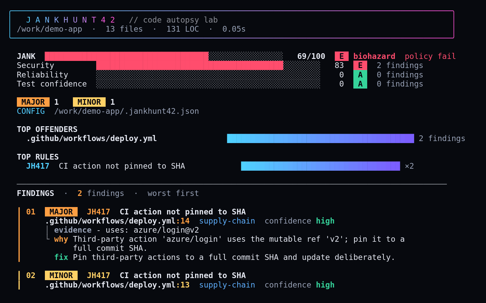
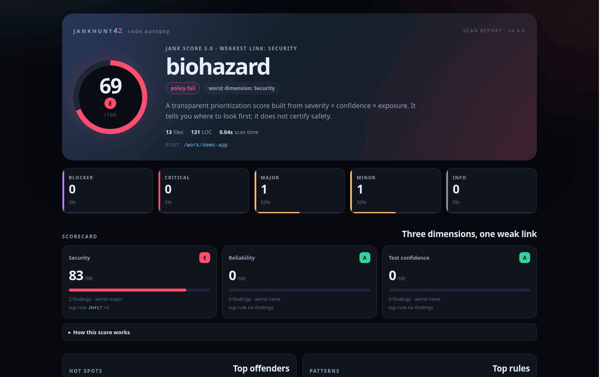
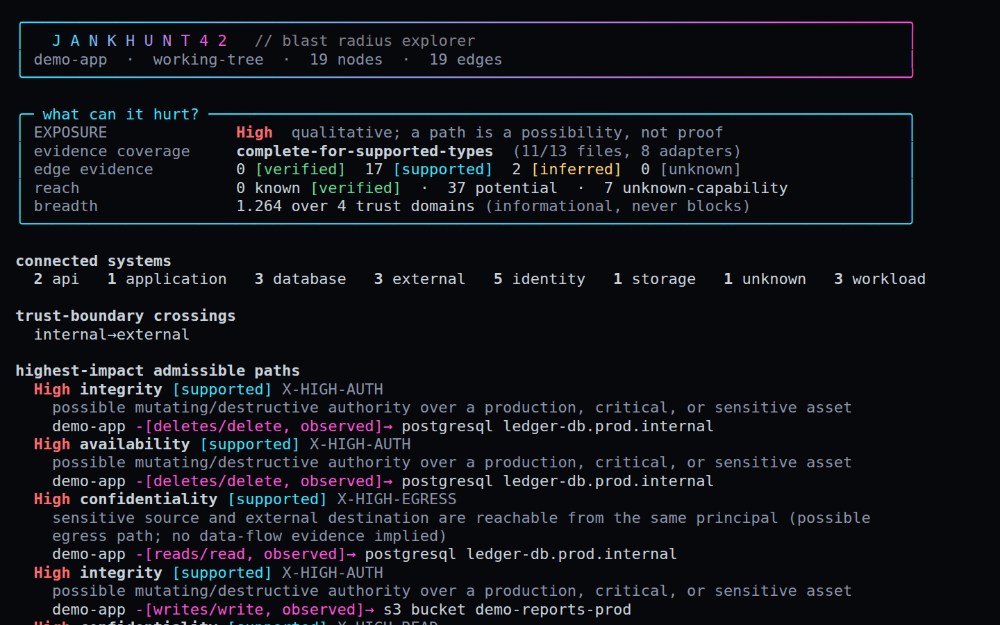
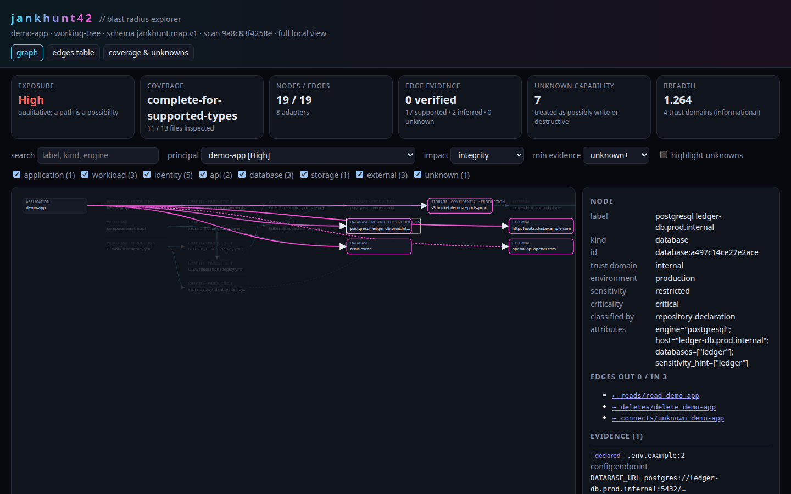
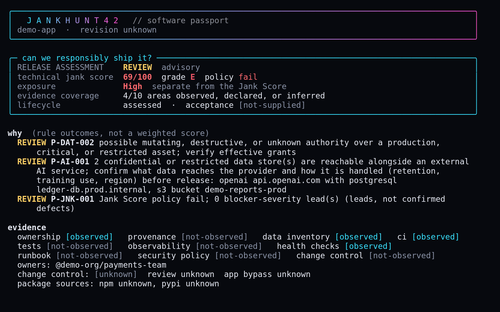
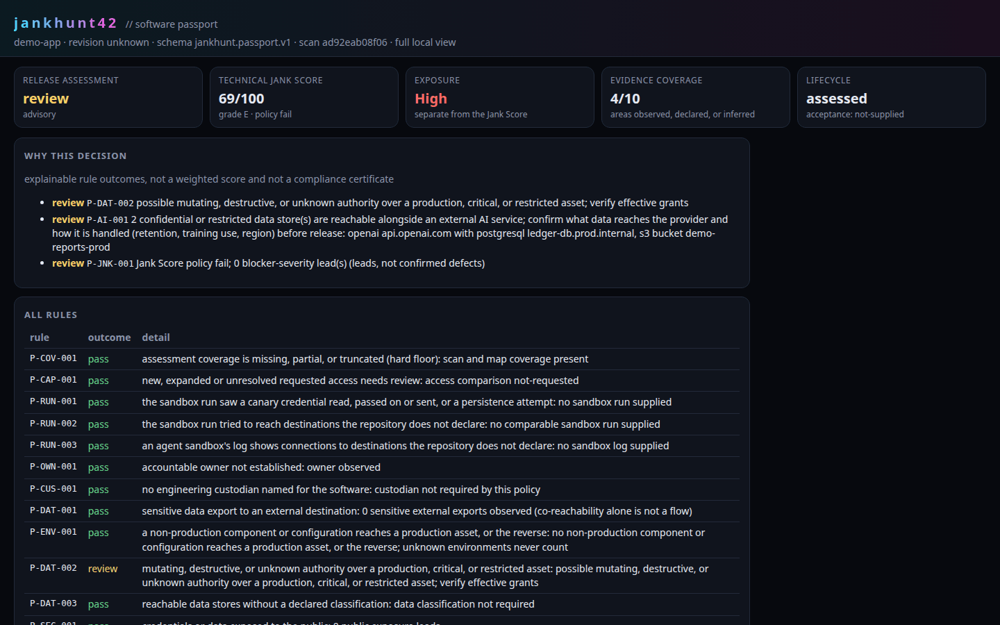
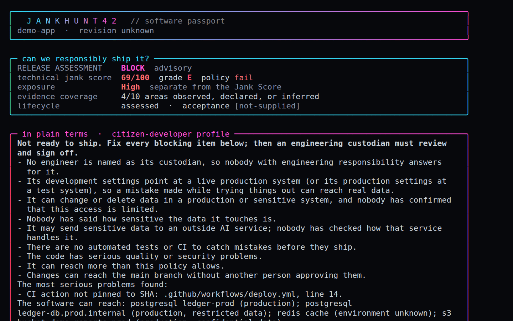
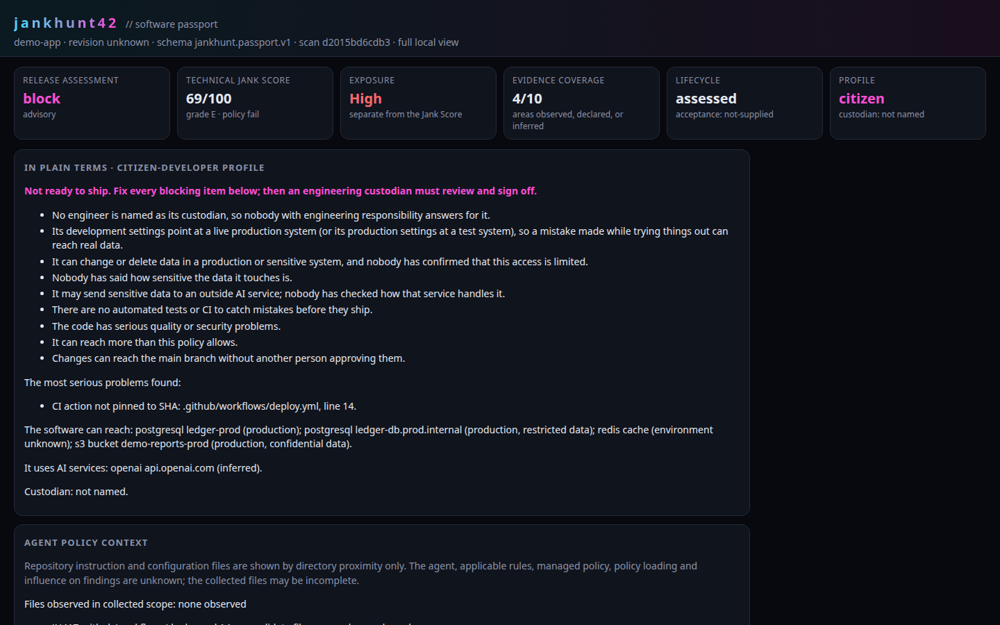
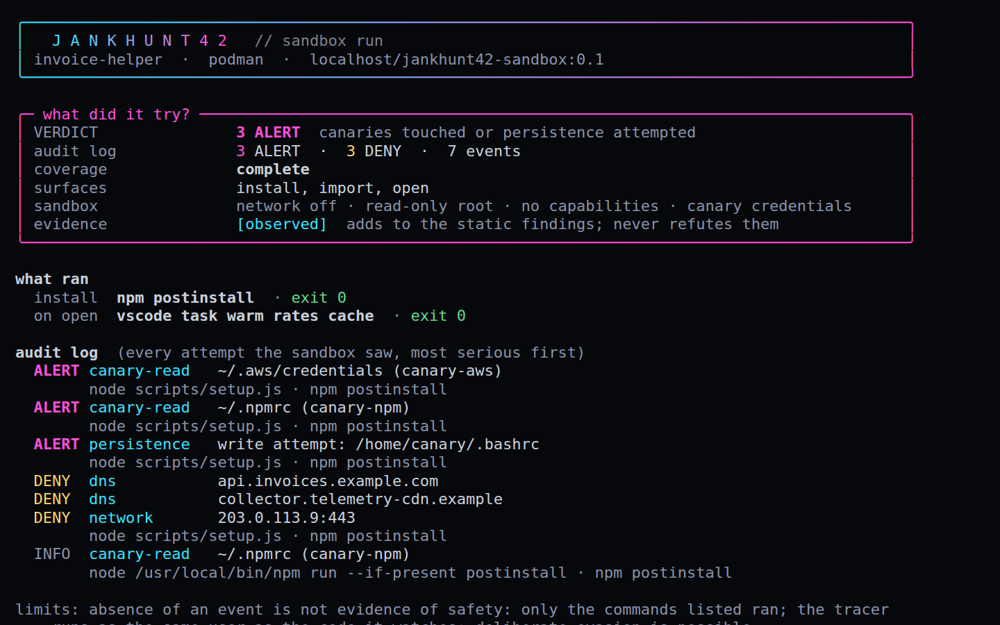
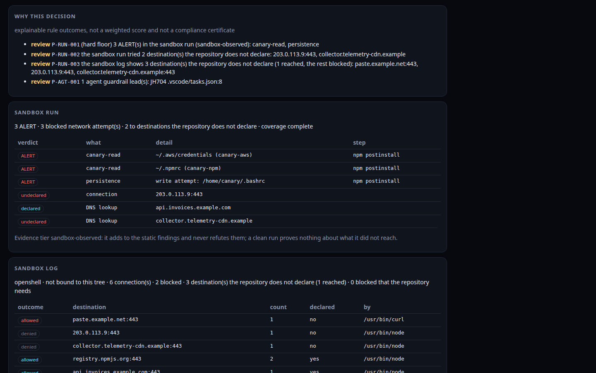

# jankhunt42

<p align="center">
  
</p>

**People who are not software engineers now ship software with AI coding agents. jankhunt42 finds the jank before it finds production, works out what it can hurt, and helps decide whether it can ship.**

AI app builders and coding agents let anyone turn an idea into running software in an afternoon. That software inherits its builder's credentials, the tools their agent is wired to, and their access to production data, often without an engineer ever looking at it. jankhunt42 is the review that is missing. It reads a repository the way a security engineer would and explains what it finds in plain terms, both to the citizen developer who built it and to the team asked to approve it.

jankhunt42 is local-first. It is an [Agent Skill](https://skills-hub.ai/skill-md) for Claude Code, Cursor, Codex CLI and OpenCode, plus a standalone CLI that needs nothing but Python 3.9+. There are no packages, no service, no telemetry, and no network access unless you ask for it (`sandbox --fetch`).

**Version:** 4.17.0 · **License:** MIT · **Runtime:** Python 3.9+ · stdlib only

## Three questions

| Question | Commands | What you get |
|---|---|---|
| **What's broken?** | `scan`, `review` | Evidence-backed leads across code, low-code exports, CI, containers, secrets, and AI-agent workspaces; Jank Score 3.0; diff review with receipts |
| **What can it hurt?** | `map`, `map --base REF` | A typed connectivity graph with a receipt per edge, covering apps, CI, Kubernetes, Terraform, n8n workflows, cloud data platforms (Azure, AWS, Google Cloud, Databricks, Snowflake) and cloud identities; confidentiality/integrity/availability blast radius; a credential blast radius per identity; trust-boundary crossings, explicit unknowns, and a graph diff |
| **Can we responsibly ship it?** | `passport`, `sandbox` | Ownership, provenance and SBOM quality, data sources, AI use, operations evidence, change control on the default branch, package sources, the Jank Score and the exposure class, joined in an explainable `pass` / `review` / `insufficient-evidence` / `block` decision; a pull-request gate recipe for citizen developers |

Each answer keeps its own evidence model:

- A Jank Score is not an exposure class, and neither is a release decision.
- A scanner lead is not a confirmed defect.
- A graph path is not proven access.
- A passport is not an approval.

## Quick start

```sh
git clone https://github.com/cloudbustinguk/jankhunt42.git ~/.config/opencode/skills/jankhunt42
alias jankhunt42="python3 ~/.config/opencode/skills/jankhunt42/scripts/jankhunt42"

cd your-repo
jankhunt42 scan .                  # what's broken?
jankhunt42 map .                   # what can it hurt?
jankhunt42 passport .              # can we responsibly ship it?
jankhunt42 map . --html > map.html # the blast radius explorer, offline
```

Output adapts to where it goes:

- **Interactive terminals** get the rich views, in the same colours as the HTML views. Colour is exact with `COLORTERM=truecolor`, and a light palette is used when `COLORFGBG` reports a light background.
- **Pipes** get clean Markdown. `NO_COLOR` or `TERM=dumb` turns colour off.
- **`--json`** gives versioned machine output.
- **`--html`** gives one self-contained, offline file.

## Citizen developers and AI agents

People who are not software engineers now build and ship software with AI coding agents. That software inherits their credentials, the tools their agent is wired to, and their access to production data. jankhunt42 governs it offline:

```sh
jankhunt42 scan . --category agent          # what an agent would do when it opens or works in this repository
jankhunt42 map .                            # what the software and its agent's MCP servers can reach
jankhunt42 passport . --profile citizen     # a strict release decision, explained in plain terms
jankhunt42 passport . --emit-sandbox-policy claude-code   # a least-privilege network fence for the agent (also codex, openshell, substrate)
jankhunt42 passport . --emit-sandbox-policy claude-code --sandbox-network-ceiling /etc/it/approved.json   # capped by IT's approved list
jankhunt42 sandbox .                    # opt-in: run the install hooks, the dependencies as they load, and what runs on open in a sandbox
jankhunt42 passport . --base <ref> --md   # what new access this change asks for (for IT to approve)
jankhunt42 passport . --base <ref> --policy /etc/it/policy.json --emit-capability-approval   # an approval record for IT to fill in
```

- **Agent workspace checks** (`JH701`-`JH714`, `JH432`):
  - an agent that holds untrusted input, private data and a way to act with nothing approving the step that acts (the Agents Rule of Two, `JH714`: MCP configurations with their Claude Code or VS Code settings, and n8n AI Agent nodes);
  - approval bypasses committed in VS Code, Claude Code, Codex, Zed, or Cursor CLI settings;
  - sandboxes that let agent commands reach any host, the Docker socket, or credential paths, or that hand their network decisions to another program (Codex, Claude Code, OpenShell, Agent Substrate), and dev containers that weaken isolation;
  - Claude Code managed settings that switch a protection off, and plugin marketplaces a project turns on for everyone;
  - Agent Substrate actor templates that put an API key inside the sandbox, and egress rules that pass a keyed API through where the gateway cannot inject the key;
  - CI that runs any pushed branch, an agent's included, with secrets or a write token;
  - commands that run on folder open, in dev containers, or in hooks;
  - agent CLIs started with bypass flags;
  - unpinned or credential-holding MCP servers;
  - hidden instructions in agent files;
  - agent skills and commands whose `allowed-tools` pre-approves any shell command;
  - untrusted issue and PR text fed to AI steps in CI.
- **Mistakes AI-built apps make** (`JH131`-`JH134`, `JH154`, `JH155`):
  - secrets behind `NEXT_PUBLIC_`/`VITE_`-style prefixes;
  - `dangerouslyAllowBrowser` LLM clients;
  - open Firebase rules, disabled row-level security, and public buckets;
  - Supabase migrations read together as one database: tables served to the API without row-level security, policies that trust `user_metadata`, and views that bypass row-level security or show `auth.users`;
  - invisible Unicode.
- **ASP.NET Core checks** (`JH135`-`JH143`): data endpoints without visible authorization, credentialed open CORS, developer errors, public HTTP listeners, interpolated SQL, unsafe type deserialization, personal fields sent to AI clients, floating NuGet versions and build downloads. See [the .NET guide](references/dotnet.md). The sandbox restores and builds hash-pinned NuGet packages offline in a separate SDK image.
- **Power Platform checks** (`JH144`-`JH153`): solution exports and flow packages, zipped or unpacked, canvas apps (`.msapp`), and Copilot Studio agents cloned with the VS Code extension (`*.mcs.yml`). Flows: HTTP triggers open to anyone, secrets shown in run history, consumer-account connectors, and personal data sent to AI services. Copilot Studio agents: no sign-in, tools that run with the maker's credentials, HTTP requests over plain HTTP or around a connector, generative orchestration with no instructions, and email sent wherever the AI chooses. Environment variables that keep a secret as plain text. Secrets in a zipped flow, a canvas app's formulas or an agent's topics are found too. See [the Power Platform guide](references/powerplatform.md).
- **n8n checks** (`JH156`-`JH159`): exported workflows, older exports included. Triggers anyone with the URL can use (Webhook, public Chat Trigger, Form Trigger); shell commands and SQL built from workflow data or written by an AI agent, critical when an open trigger feeds them; and personal fields sent to an AI model. See [the n8n guide](references/n8n.md).
- **The citizen profile** will not pass a release without:
  - an owner, and an engineering custodian named by the operator;
  - observed tests and CI;
  - declared data classification.

  It blocks on public exposure, agent-guardrail leads, sensitive data reachable alongside an AI service, exposure above Moderate, unverified authority over production data, and a development configuration that points at production (or the reverse). The repository can opt in to the profile but never out.
- **AI governance**:
  - The passport inventories the AI model services and agent tooling a repository uses.
  - Every rule maps to the NIST AI RMF and AIGP outcomes it informs. This is orientation, not certification.
  - Every scanner rule names the OWASP Citizen Development (`CD-SEC`) and Agentic Applications (`ASI`) risks its findings are an instance of: in the catalog, in each report format (SARIF tags included), and counted in the passport. Also orientation.
- **Fix prompts**: every finding carries a short instruction for the citizen's coding agent (Claude Code, Cursor, Copilot): the file, the change and the check to rerun, never a secret's value. `jankhunt42 scan . --prompt` prints one prompt for all of them, most serious first.

Details and limits: [`references/citizen.md`](references/citizen.md) and [`references/ai-governance.md`](references/ai-governance.md).

## Gallery

Real output from the synthetic fixture `tests/fixtures/demo-app`, a fictional payments service. The citizen example is a small synthetic app built the way AI app builders do. Its agent settings are deliberately unsafe, so it is not checked in.

<table>
  <tr>
    <th width="50%">In the terminal</th>
    <th width="50%">As one offline HTML file (<code>--html</code>)</th>
  </tr>
  <tr>
    <td colspan="2"><b>What's broken?</b> <code>jankhunt42 scan .</code>: the Jank Score, its dimensions, hot spots, and every finding with its evidence.</td>
  </tr>
  <tr>
    <td></td>
    <td></td>
  </tr>
  <tr>
    <td colspan="2"><b>What can it hurt?</b> <code>jankhunt42 map .</code>: the exposure class, evidence coverage, trust-boundary crossings, and the highest-impact paths. The explorer is shown with the application's integrity blast radius highlighted.</td>
  </tr>
  <tr>
    <td></td>
    <td></td>
  </tr>
  <tr>
    <td colspan="2"><b>Can we responsibly ship it?</b> <code>jankhunt42 passport .</code>: the decision, the rules that produced it (including sensitive data reachable alongside an AI service), the evidence areas, and the AI services in use.</td>
  </tr>
  <tr>
    <td></td>
    <td></td>
  </tr>
  <tr>
    <td colspan="2"><b>Software built by citizen developers.</b> <code>jankhunt42 passport . --profile citizen</code> leads with a plain-language brief: why it blocks (here, among other things, development settings that point at the production database), what the software and its AI agent's tool servers can reach, and who must sign off.</td>
  </tr>
  <tr>
    <td></td>
    <td></td>
  </tr>
  <tr>
    <td colspan="2"><b>Run it in a sandbox (opt-in).</b> <code>jankhunt42 sandbox .</code> runs the install hooks and what runs when the folder is opened, in a disposable container with the network off and canary credentials, and reads like a firewall log. <code>passport --sandbox-run</code> sets what it tried against what the code declares, and <code>passport --sandbox-log</code> does the same for an AI agent's own sandbox (OpenShell or Agent Substrate).</td>
  </tr>
  <tr>
    <td></td>
    <td></td>
  </tr>
</table>

Text output for the same fixture, regenerated by the test suite on every run, is in [`references/examples.md`](references/examples.md), with notes on how to read it.

## Commands

```sh
# What's broken?
jankhunt42 scan .                        # TTY "code autopsy"; Markdown when piped
jankhunt42 scan . --json                 # full machine report
jankhunt42 scan . --sarif > jank.sarif   # SARIF 2.1.0 for code scanning
jankhunt42 scan . --html > jankhunt42.html
jankhunt42 scan . --prompt               # one prompt to paste into your coding agent to fix the findings
jankhunt42 scan . --fail-on critical     # explicit CI gate
jankhunt42 scan . --score --json         # Jank Score 3.0 breakdown
jankhunt42 rules --category security     # the rule catalog
jankhunt42 review . --base HEAD~1 --json # committed changes, with receipts
jankhunt42 review . --staged --md
jankhunt42 review . --commit HEAD --brief            # handoff for a semantic reviewer
jankhunt42 review . --base HEAD~1 --save-baseline baseline.json --json
jankhunt42 review . --base HEAD~1 --baseline baseline.json --fail-on major

# What can it hurt?
jankhunt42 map . --json                        # jankhunt.map.v1 (templates/map.schema.json)
jankhunt42 map . --base HEAD~1 --json          # graph delta from committed git objects only
jankhunt42 map . --redact --json               # shareable: pseudonymous IDs, no hosts or snippets
jankhunt42 map . --inventory ../inventory.json # operator inventory: classifications and verified grants

# Can we responsibly ship it?
jankhunt42 passport . --json                   # jankhunt.passport.v1 (templates/passport.schema.json)
jankhunt42 passport . --html > passport.html   # printable, offline
jankhunt42 passport . --policy ../policy.json  # operator policy (outside the repo)
jankhunt42 passport . --fail-on block          # opt-in enforcement: exit 1 at or above block
jankhunt42 passport . --compare ../old-passport.json      # regressions since a stored passport
jankhunt42 passport . --acceptance ../acceptance.json     # operator acceptance, bound to revision and policy
jankhunt42 sandbox . --json                   # opt-in sandbox run of the install hooks and what runs on open
jankhunt42 sandbox . --fetch https://registry.npmjs.org/ --json   # dependencies' hooks too: fetches the pinned npm packages, verified
jankhunt42 passport . --sandbox-run /path/outside/run.json   # carry a saved run into the passport (P-RUN-001, P-RUN-002)
jankhunt42 passport . --sandbox-log /path/outside/ocsf.jsonl   # what an agent's own sandbox (OpenShell, Agent Substrate) let through or blocked (P-RUN-003)
jankhunt42 passport . --branch-rules ../rules/app.json    # rulesets exported by an operator: is review enforced?
jankhunt42 selftest --full                                # self-assurance, with a pass/fail gate
```

Policy precedence is defaults, then an operator `--policy` from outside the repository, then hard floors. Repository config can only tighten. Jank Score 3.0 is a transparent prioritization device: three dimensions (security, reliability, tests), A-E grades, and a headline anchored to the worst dimension.

## The evidence model

| State | Meaning |
|---|---|
| `observed` | The repository directly contains it: a literal endpoint, an SQL verb in a string, an HTTP call |
| `declared` | Configuration or a manifest says so: env values, Kubernetes RBAC, workflow `permissions:`, `.jankhunt42.json` declarations |
| `inferred` | A heuristic: an SDK import, a manifest dependency, an endpoint resolved by environment-variable name |
| `provider-verified` / `verified` | From an operator-supplied inventory **outside** the repository, or an exporter-recorded attestation verification |
| `unknown` | Not established. Never treated as safe, never as proven dangerous |
| `refuted` | Explicitly refuted by a trusted operator inventory, and excluded |

Paths take the strength of their weakest edge. "Known" reach means verified; everything else is potential.

## Configuration

`.jankhunt42.json` is discovered upward from the scan root (`.toml` also works on Python 3.11+):

- It tunes rules, severities, path scopes and ignores.
- Its `passport` section holds repository declarations: owners, asset sensitivity and criticality, operations evidence, and tighten-only policy.

```json
{
  "rules": {"JH306": {"enabled": false}},
  "paths": {"legacy/**": {"severity": {"JH101": "info"}}},
  "ignore": ["vendor/**"],
  "passport": {
    "owners": ["@example-org/payments"],
    "assets": [{"match": "ledger-db", "sensitivity": "restricted", "criticality": "critical"}],
    "policy": {"require": {"owner": true}}
  }
}
```

Suppress a confirmed false positive inline, with a reason: `# jankhunt42: ignore JH201`. File-level suppression is `# jankhunt42: ignore-file JH204`, in the first 12 lines.

## Privacy and security

- **Offline by default.** Only `sandbox --fetch URL` reaches a network: it downloads the hash-pinned packages a lockfile names, from the origins you give it. `scan`, `review`, `map` and `passport` never resolve, probe, or connect to anything they find.
- **Redaction.** Credentials, URL userinfo, query strings, connection-string secrets, keys, tokens and emails are removed before anything is hashed, displayed or stored. Repository control characters are neutralized before they reach a terminal. HTML output escapes everything and runs under a no-network content security policy.
- **Sharing.** A connectivity graph can reveal internal topology, so use `--redact` for anything you share. Generated artifacts contain relative paths only.
- **Untrusted repositories.** jankhunt42 never executes repository code. Instructions embedded in repository content are data, not commands. Its Git calls switch off every way a repository's own configuration can name a program (hooks, fsmonitor, clean/smudge filters, diff drivers and text converters, signature checking), never write the index or use the network, and drop inherited variables that name a program (`GIT_EXTERNAL_DIFF`, `GIT_SSH_COMMAND`, `GIT_PAGER`, editors). A test proves each of these runs under plain Git and never under jankhunt42.

## Install as an agent skill

jankhunt42 is one `SKILL.md` directory. Put it where your tool already looks for skills:

| Tool | Project scope | User scope |
| --- | --- | --- |
| Claude Code | `.claude/skills/jankhunt42/` | `~/.claude/skills/jankhunt42/` |
| Cursor | `.cursor/skills/jankhunt42/` | — |
| Codex CLI | `.codex/skills/jankhunt42/` (also reads `.agents/skills/`) | `~/.codex/skills/jankhunt42/` |
| OpenCode | `.opencode/skills/jankhunt42/` (also reads `.claude/skills/`, `.agents/skills/`) | `~/.config/opencode/skills/jankhunt42/` |

The skill routes requests to the matching command and reference:

- scanning and diff review;
- mapping, exposure and blast radius;
- passport and release readiness;
- citizen-developer governance.

It never runs a repository's code without explicit permission. The listing on [skills-hub.ai](https://skills-hub.ai/skills/jankhunt42) carries the `SKILL.md` instructions only; clone the repository to get the CLI.

### Verifying a release

Every `vX.Y.Z` tag is built into a source tarball and attested in CI with a [GitHub Artifact Attestation](https://docs.github.com/en/actions/security-guides/using-artifact-attestations-to-establish-provenance-for-builds) (keyless Sigstore, tied to this repository's Actions identity):

```sh
gh attestation verify jankhunt42-<version>.tar.gz -R cloudbustinguk/jankhunt42
```

This confirms the tarball came from this repository's CI at the tagged commit. It says nothing about any marketplace's review.

## CI integration

```yaml
name: jankhunt42
on: [push, pull_request]
permissions:
  contents: read
  security-events: write
jobs:
  assure:
    runs-on: ubuntu-latest
    steps:
      - uses: actions/checkout@v7   # pin to a SHA in production
        with:
          fetch-depth: 0
          persist-credentials: false
      - uses: actions/setup-python@v6
        with:
          python-version: "3.12"
      - run: python3 .opencode/skills/jankhunt42/scripts/jankhunt42 scan . --sarif > jankhunt42.sarif
      - name: What changed in what it can reach
        if: github.event_name == 'pull_request'
        run: python3 .opencode/skills/jankhunt42/scripts/jankhunt42 map . --base "${{ github.event.pull_request.base.sha }}" --md >> "$GITHUB_STEP_SUMMARY"
      - name: Passport (enforced; add --profile citizen for software built by non-engineers)
        run: python3 .opencode/skills/jankhunt42/scripts/jankhunt42 passport . --json --fail-on block > passport.json
      - uses: github/codeql-action/upload-sarif@v4
        if: always()
        with:
          sarif_file: jankhunt42.sarif
```

Keep enforcement explicit. The gates are:

- `scan --fail-on SEV`;
- `review --fail-on SEV`, with a baseline;
- `passport --fail-on OUTCOME`.

Everything else is advisory.

## Exit codes

| Code | Meaning |
|---|---|
| `0` | Ran successfully and no explicit gate tripped (`map` and an advisory `passport` always exit 0) |
| `1` | A gate tripped: `--fail-on`, `scan --score --fail-policy`, a failing `selftest`, or a sandbox ALERT |
| `2` | Usage error, unreadable input, unresolvable git ref, or invalid inventory/policy file |
| `130` | Interrupted |

## Limits

- **Static evidence only.** Findings and edges come from text, not data flow or runtime observation. They can miss things and can fire on examples. Effective privileges are never proven from a repository.
- **Agents.** Agent rules read configuration; they do not run the agent or its MCP servers. The citizen profile governs a release decision; it is not a sandbox.
- **Decisions.** Exposure classes and passport decisions are explainable heuristics, not probabilities or compliance results. The NIST AI RMF and AIGP crosswalk is orientation only.
- **Supply chain.** The passport records SBOM and provenance files it finds and verifies no cryptography; use `gh attestation verify` or `cosign`. SBOM quality counts fields; it does not judge their accuracy. Dependency advisories are out of scope: use Dependabot or osv-scanner.

If a finding is wrong, confirm it in context, then suppress it with a reason or improve the rule. A scanner that cries wolf is worse than no scanner.

## Documentation
| Reference | Covers |
|---|---|
| [`references/examples.md`](references/examples.md) | Text output for the demo fixture, and how to read it |
| [`references/connectivity.md`](references/connectivity.md) | `map`: adapters, edge semantics, blast radius, exposure, inventory format, graph deltas |
| [`references/passport.md`](references/passport.md) | `passport`: sections, rules, policy precedence, declarations, acceptance, comparison |
| [`references/citizen.md`](references/citizen.md) | The citizen profile, agent workspace checks, and the incidents they map to |
| [`references/ai-governance.md`](references/ai-governance.md) | AI-use inventory, `P-AI-001`, the NIST AI RMF / AIGP crosswalk, and OWASP risks per rule |
| [`references/scoring.md`](references/scoring.md) | Jank Score 3.0 formula, weights, and limits |
| [`references/impact-model.md`](references/impact-model.md) | the impact maths: evidence tiers, the exposure class, the Agents Rule of Two, and the planned `jankhunt.impact.v2` |
| [`references/precision.md`](references/precision.md) | How often a finding is worth a look: labelled samples, method, limits |
| [`references/review.md`](references/review.md) | Diff review protocol, receipts, baselines |
| [`references/n8n.md`](references/n8n.md) | n8n workflows: what they reach, credentials by name, the JH156-JH159 checks, comparing versions |
| [`references/powerplatform.md`](references/powerplatform.md) | Power Automate flows in solution exports and flow packages: open HTTP triggers, secrets in run history, consumer connectors, personal data to AI |
| [`references/change-review.md`](references/change-review.md) | `passport --base`: the new access a change asks for, and approving one change so CI passes it next time |
| [`references/sandbox.md`](references/sandbox.md) | `sandbox`: running the install hooks, the dependencies as they load, and what runs on open in a sandbox, the audit log, canaries and limits |
| [`references/dotnet.md`](references/dotnet.md) | ASP.NET Core leads, their limits, and offline NuGet restore/build |
| [`references/rulesets.md`](references/rulesets.md) | site rulesets (`--ruleset`) and `--ignore-rule`: your own rules, shipped rules set aside or re-rated, and trust |
| [`references/development.md`](references/development.md) | Architecture, development workflow, self-assurance, compatibility and migration notes |
| [`CHANGELOG.md`](CHANGELOG.md) | Every release |

## License

MIT. See `LICENSE`.

---

Built for people who would rather read one causal chain than ten dashboards.
